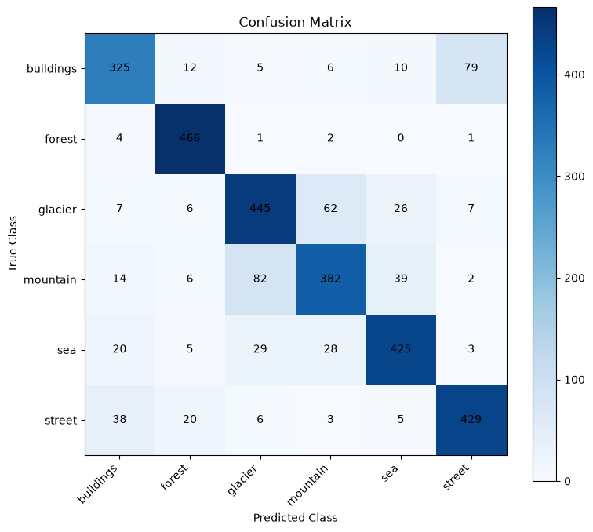
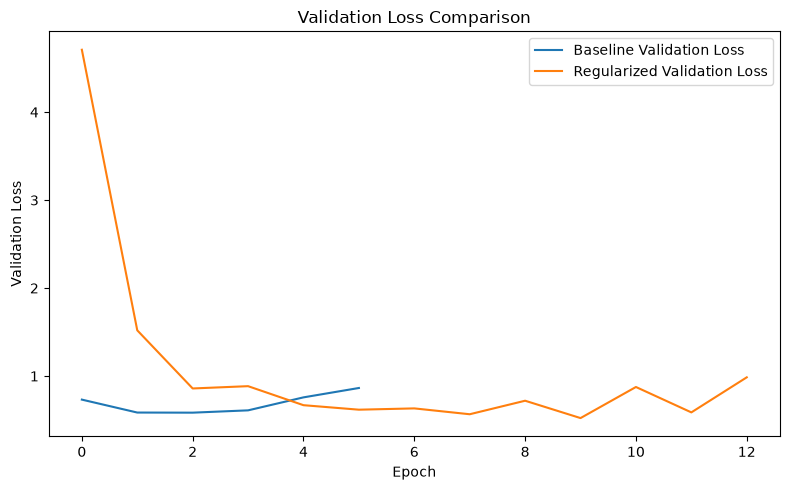

# Natural Scene Classification with CNNs

A TensorFlow/Keras computer vision project that trains a convolutional neural network from scratch to classify images as **buildings, forest, glacier, mountain, sea, or street**.

**Recorded test accuracy: 82.40% · Weighted F1-score: 82.25% · 3,000 test images**



## Approach

- Load and inspect the Intel Image Classification dataset using KaggleHub.
- Resize RGB images to 128 × 128 and normalize pixels inside the model.
- Split the 14,034-image training directory into 11,228 training and 2,806 validation images.
- Compare a baseline CNN against a configuration with batch normalization, dropout, and a lower learning rate.
- Select the model by minimum validation loss, then evaluate on the separate test directory.
- Analyze per-class precision, recall, F1-score, and confusion patterns.

## Architecture

Three Conv2D blocks (32, 64, 128 filters; 3 × 3 kernels; same padding; ReLU), each followed by optional batch normalization and 2 × 2 max pooling. Flattened features feed a 128-unit dense layer, optional dropout, and a six-class softmax output. Pixel rescaling is part of the model.

The regularized configuration has 4,289,350 total parameters. Most parameters are in the dense layer.

## Experiments

| Setting | Baseline | Regularized |
|---|---:|---:|
| Dropout | 0 | 0.5 |
| Batch normalization | No | Yes |
| Adam learning rate | 0.001 | 0.0005 |
| Best validation accuracy | 79.94% | 83.00% |
| Minimum validation loss | 0.584185 | 0.522606 |

Both use batch size 32, sparse categorical cross-entropy, up to 15 epochs, and early stopping on validation loss with patience 3 and best-weight restoration. The regularized run restored epoch 10. Best validation accuracy is the maximum across epochs, while selection uses minimum validation loss.



## Recorded results

| Test metric | Value |
|---|---:|
| Accuracy | 82.40% |
| Weighted precision | 82.24% |
| Weighted recall | 82.40% |
| Weighted F1-score | 82.25% |
| Loss | 0.538864 |

Forest has the highest class F1-score (94.24%); mountain has the lowest (75.79%). Mountain/glacier and buildings/street account for prominent confusions.

These numbers and figures come from the saved outputs of the original notebook. Repository preparation did not include retraining. Seeds are set to 42, but exact results may vary by runtime and hardware. Three settings changed together between experiments, so the comparison does not isolate the effect of each setting.

## Setup and training

The original notebook records Python 3.12.9 and TensorFlow 2.21.0. TensorFlow is pinned to that recorded version; other dependencies are not a complete environment lock.

```bash
python -m venv .venv
```

Activate on Windows PowerShell:

```powershell
.venv\Scripts\Activate.ps1
```

Activate on macOS/Linux:

```bash
source .venv/bin/activate
```

Then, from the repository root:

```bash
python -m pip install -r requirements.txt
python -m jupyter lab notebooks/intel_scene_classification.ipynb
```

Run all cells from top to bottom. KaggleHub downloads the dataset and requires internet access. If authentication is requested, configure your Kaggle credentials outside the repository. Dataset layout: `seg_train/seg_train/<class>` and `seg_test/seg_test/<class>`.

The notebook saves result CSVs to `results/` and the selected model plus class labels to `models/`. Model weights and dataset images are not bundled. Train the notebook before running inference.

## Predict an image

```bash
python predict.py path/to/image.jpg
```

This prints all six softmax scores in descending order. Scores are model outputs, not calibrated confidence guarantees. The model always assigns one of the six classes and has no out-of-distribution rejection mechanism.

## Files

| Path | Purpose |
|---|---|
| `notebooks/intel_scene_classification.ipynb` | Training, comparison, evaluation, and original saved outputs |
| `predict.py` | Single-image inference using the exported model |
| `results/recorded_metrics.json` | Recorded evaluation metrics and confusion matrix |
| `assets/` | Figures extracted from the original notebook |
| `requirements.txt` | Runtime dependencies |

## Limitations and next steps

The validation split is random rather than explicitly stratified. The model was evaluated on one dataset split; there is no cross-validation or external-domain evaluation. Potential extensions include data augmentation, global average pooling to reduce parameters, and transfer learning, followed by validation-based selection.

## Dataset

[Intel Image Classification on Kaggle](https://www.kaggle.com/datasets/puneet6060/intel-image-classification), published by Puneet Bansal. The dataset is downloaded separately; consult the source page for its terms. This project is an academic image-classification implementation and is not affiliated with Intel.
